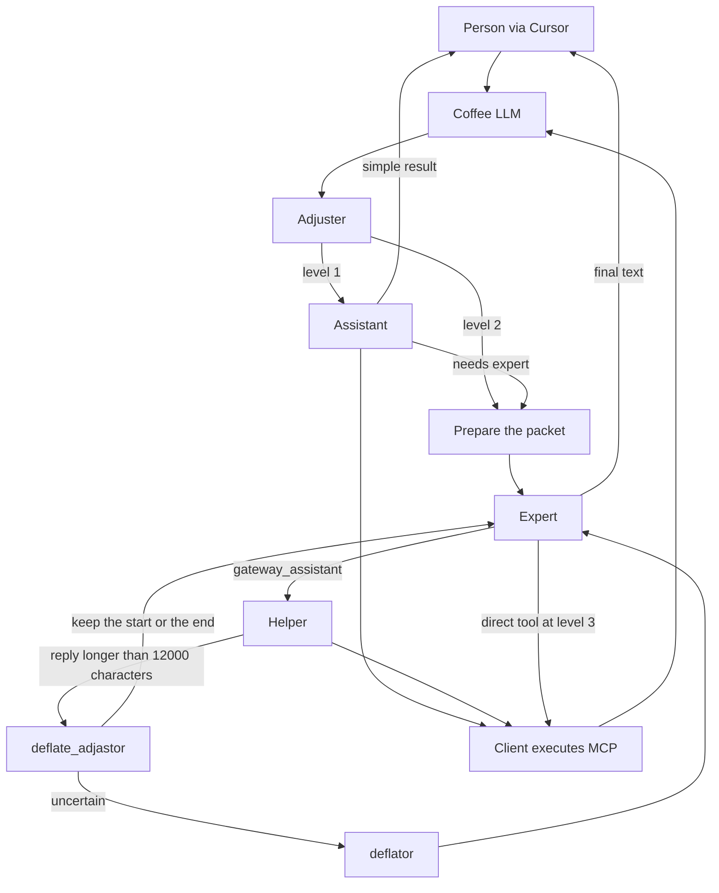

# Coffebreak AI Context Gateway

[English](README.md) · [Русский](README.ru.md) · [简体中文](README.zh-cn.md)

[](pyproject.toml)

[](https://github.com/coffeebreak-ai/coffee-llm/commits/main)
[](https://github.com/coffeebreak-ai/coffee-llm/issues)
[](https://github.com/coffeebreak-ai/coffee-llm/pulls)

A personal gateway in front of an expensive model. In Cursor and Codex the model is named `Coffee LLM`. In code and commands the name without a space is `coffee_llm`. The person talks to one address, and the gateway decides who leads the turn: the assistant gathers data, the expert judges and answers.

## Mission

The expensive model receives judgment, not a raw archive of the conversation and tool output. A cheaper helper does the gathering, search, and follow-up reading. The expert still writes the answer for the person when the task needs it.

## Goals

- Reduce the expert's input tokens per call and per completed task.
- Keep provider cache hits: the start of the expert request that was already sent is only appended to.
- Do not lose the rules, the person's current message, paths, line numbers, or a way to retrieve the full source.
- Leave the request for an external tool with the model. The client opens the connection to the MCP server.

The full turn contract, the boundaries, and the task list are kept locally and are not part of this repository.

## Expert–assistant pattern

The expert owns the dialogue with the person and does not receive every intermediate Read or Grep. The assistant handles a simple task or carries out a finished assignment from the expert, returning one result.

The reference for the shape of a turn is [DeepSeek Harness](https://github.com/deepseek-ai/deepseek-harness): one model step together with its tools, and a history that is not rebuilt. The idea of a stable prefix and of compressing context before an expensive call comes from there. The plugin catalog and the profile tree are not carried over. Splitting the expert and assistant roles is this gateway's route.

Access has three levels and only rises. There is no direct `1 → 3` and no downgrade.

| Level | Who answers the person | Tools |
| --- | --- | --- |
| 1 | Assistant | Full catalog from the client request |
| 2 | Expert | Only `gateway_assistant`; the helper receives the full catalog |
| 3 | Expert | Full catalog and `gateway_assistant` |

The adjuster chooses `1 → 2` without a numeric threshold: if the whole result cannot confidently be left with the assistant, the turn goes to the expert. `2 → 3` requires `ADJUSTER_ESCALATION_CONFIDENCE` (default `0.80`). That is confidence that the expert needs direct tools, not a judgment of whether the data is true. The adjuster is not called between helper steps.

At level 2 the expert may assign several independent tasks in one reply. Each one is a separate `gateway_assistant` call. Helpers work one after another; the external calls they need are returned to the client. The model orders the call, the client opens MCP and brings the result in the next message. The gateway itself does not connect to MCP servers.

## How it is assembled



For a new dialogue with `COMPACT_EXPERT_CONTEXT=on`, the helper prepares the packet once, before the expert's first call. The code copies the required rules and the person's current message verbatim. After that the expert's working history is only appended to; old dialogues are not migrated to the new format.

After the helper's subdialogue the expert receives one structured result, not every step. A fragment of up to 12,000 characters passes through whole. A longer one is examined by `deflate_adjastor`: keep the start, keep the end, or, if it is unclear, pass the text to `deflator` to select excerpts without tools. The full result is available by `source_id`. External calls are not removed and are still returned to the client.

## Metrics

Measured on 29 October 2026. Roles in these runs: the expert and the expert-only run — `gpt-6.1-sol`, effort `medium`; the assistant — `gpt-6-luna`, effort `medium`; the adjuster and `deflate_adjastor` — `jev-latest`; `deflator` — `gpt-6-luna`. Adjuster and compression tokens are not in the tables. There are few metrics; the ones counted are below: input and cache. Savings is only the input percentage: expert-only minus the expert.

### Reading and comparison

| | Input | Cache |
| --- | ---: | ---: |
| Expert | 95 750 | 6 533 |
| Assistant | 375 067 | 138 839 |
| Expert only | 759 777 | 748 922 |
| Savings | 87 % | |

### Code edit

| | Input | Cache |
| --- | ---: | ---: |
| Expert | 353 805 | 200 580 |
| Assistant | 3 978 256 | 2 914 298 |
| Expert only | 5 732 661 | 5 314 802 |
| Savings | 94 % | |

## Quick start

Python 3.15 or newer is required. `pyproject.toml` has no third-party dependencies, so a `pip` install is not needed. `OPENAI_API_KEY` is required even with local models: by default the expert (`gpt-6.1-sol`) and the helper (`gpt-6-luna`) use the OpenAI Responses API. The default OpenAI address is `https://api.openai.com/v1`.

1. In the repository root, copy `.env.example` to `.env` and set `OPENAI_API_KEY`.
2. By default the adjuster runs locally through Ollama. Install and start Ollama, then run `ollama pull nimble-v3:latest`. For Jev, set `ADJUSTER_BACKEND=jev` and `JEV_API_KEY`; Ollama is then not needed for the adjuster, but `OPENAI_API_KEY` is still required.
3. Start the gateway from the repository root:

```bash
python3 -m coffee_llm
```

With the standard `PORT=8080` the gateway listens on `http://127.0.0.1:8080`. If Cursor is on another machine, start ngrok on that port:

```bash
ngrok http 8080
```

In Cursor, set the OpenAI-compatible Base URL to the https address ngrok prints, with `/v1` at the end. Select the model `Coffee LLM`. ngrok only delivers the request to the local gateway. Do not point the tunnel at the MCP or Graphiti ports.

Codex on the same machine reads `~/.codex/config.toml`, not `config.yaml`. Point it at the gateway, then fully quit and reopen Codex:

```toml
model = "Coffee LLM"
model_provider = "coffee"

[model_providers.coffee]
name = "Coffee LLM"
base_url = "http://127.0.0.1:8080/v1"
wire_api = "responses"
requires_openai_auth = false
```

If Codex is on another machine, use the ngrok https address with `/v1` as `base_url`.

Graphiti is optional: the gateway works with it and without it. The step-by-step notes for Open WebUI are kept locally and are not part of this repository. All keys live only in the local `.env`; it and `data/` are excluded from Git.

License [MIT](LICENSE).
