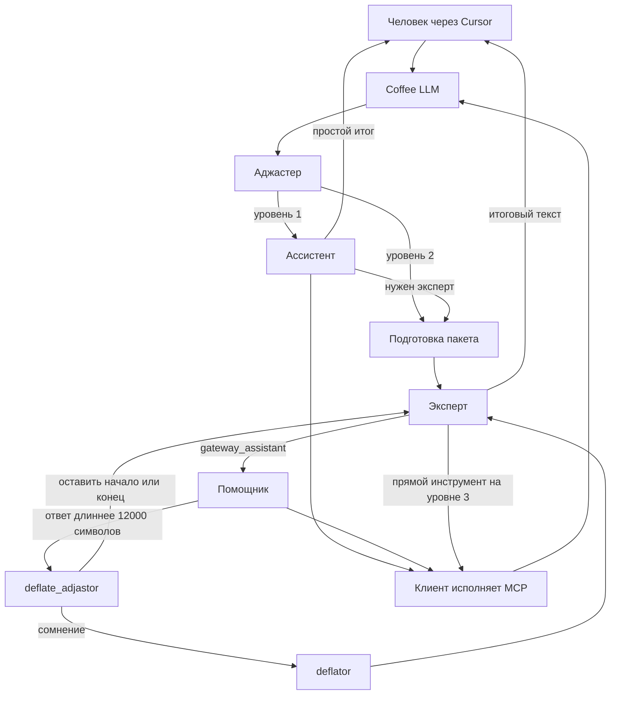

# Coffebreak AI Context Gateway

[English](README.md) · [Русский](README.ru.md) · [简体中文](README.zh-cn.md)

[](pyproject.toml)

[](https://github.com/coffeebreak-ai/coffee-llm/commits/main)
[](https://github.com/coffeebreak-ai/coffee-llm/issues)
[](https://github.com/coffeebreak-ai/coffee-llm/pulls)

Личный шлюз перед дорогой моделью. В Cursor и Codex модель называется `Coffee LLM`. В коде и командах без пробела имя `coffee_llm`. Человек говорит с одним адресом, а шлюз решает, кто ведёт ход: ассистент собирает данные, эксперт судит и отвечает.

## Миссия

Дорогой модели достаётся суждение, а не сырой архив переписки и выводов инструментов. Сбор, поиск и дочитывание делает более дешёвый помощник. Итог человеку по-прежнему формулирует эксперт, когда задача этого требует.

## Цели

- Уменьшить входные токены эксперта на вызов и на завершённую задачу.
- Сохранить попадание в кэш поставщика: уже отправленное начало запроса эксперта только дополняется.
- Не терять правила, текущую реплику человека, пути, строки и способ достать полный источник.
- Оставить заказ внешних инструментов у модели. Соединение с сервером MCP открывает клиент.

Полный контракт хода, границы и список задач ведутся локально и в этот репозиторий не входят.

## Паттерн «эксперт — ассистент»

Эксперт владеет диалогом с человеком и не получает каждый промежуточный Read или Grep. Ассистент ведёт простую задачу или выполняет законченное поручение эксперта, возвращая ему один результат.

Ориентир по устройству хода — [DeepSeek Harness](https://github.com/deepseek-ai/deepseek-harness): один шаг модели вместе с её инструментами и история, которую не пересобирают. Оттуда взята идея устойчивого префикса и сжатия контекста перед дорогим вызовом. Каталог плагинов и дерево профилей не переносятся. Разделение ролей эксперта и ассистента — маршрут этого шлюза.

Три уровня доступа только повышаются. Прямого перехода `1 → 3` и понижения нет.

| Уровень | Кто отвечает человеку | Инструменты |
| --- | --- | --- |
| 1 | Ассистент | Полный каталог из запроса клиента |
| 2 | Эксперт | Только `gateway_assistant`; помощник получает полный каталог |
| 3 | Эксперт | Полный каталог и `gateway_assistant` |

Аджастер выбирает `1 → 2` без численного порога: если весь результат нельзя уверенно оставить ассистенту, ход переходит эксперту. Переход `2 → 3` требует `ADJUSTER_ESCALATION_CONFIDENCE` (по умолчанию `0.80`). Это уверенность в необходимости дать эксперту прямые инструменты, а не оценка истинности данных. Между шагами помощника аджастер не вызывается.

На уровне 2 эксперт может в одном ответе поручить несколько независимых задач. Каждая — отдельный вызов `gateway_assistant`. Помощники работают по очереди; необходимые внешние вызовы возвращаются клиенту. Модель заказывает вызов, клиент открывает MCP и приносит результат следующим сообщением. Сам шлюз к серверам MCP не подключается.

## Как это собрано



У нового диалога с `COMPACT_EXPERT_CONTEXT=on` помощник один раз готовит пакет до первого вызова эксперта. Код дословно добавляет обязательные правила и текущую реплику человека. Затем рабочая история эксперта только дополняется; старые диалоги не мигрируют на новый формат.

После поддиалога помощника эксперту передаётся один структурированный результат, а не каждый его шаг. Фрагмент до 12 000 символов проходит целиком. Более длинный разбирает `deflate_adjastor`: оставить начало, оставить конец или, если неясно, передать текст `deflator` для отбора без инструментов. Полный результат доступен по `source_id`. Внешние вызовы не удаляются и по-прежнему возвращаются клиенту.

## Структура репозитория

Оркестрация диалога собрана в `coffee_llm/dialogue/`: `engine.py` отвечает за состояние и маршрутизацию, а `expert.py`, `helper.py`, `packet.py` и `deflate.py` реализуют связанные потоки. Файлы верхнего уровня `coffee_llm/expert.py`, `helper.py`, `packet.py` и `deflate.py` оставлены явными совместимыми реэкспортами. Точка входа `coffee_llm/__main__.py` остаётся на месте.

## Метрики

Замеры 29 октября 2026. Роли этих прогонов: эксперт и «только эксперт» — `gpt-6.1-sol`, усилие `medium`; ассистент — `gpt-6-luna`, усилие `medium`; аджастер и `deflate_adjastor` — `jev-latest`; `deflator` — `gpt-6-luna`. Токены аджастера и сжатия в таблицы не входят. Метрик мало, посчитанные стоят ниже: вход и кеш. Экономия — только процент входа: «только эксперт» минус «эксперт».

### Чтение и сравнение

| | Вход | Кеш |
| --- | ---: | ---: |
| Эксперт | 95 750 | 6 533 |
| Ассистент | 375 067 | 138 839 |
| Только эксперт | 759 777 | 748 922 |
| Экономия | 87 % | |

### Правка кода

| | Вход | Кеш |
| --- | ---: | ---: |
| Эксперт | 353 805 | 200 580 |
| Ассистент | 3 978 256 | 2 914 298 |
| Только эксперт | 5 732 661 | 5 314 802 |
| Экономия | 94 % | |

## Быстрый запуск

Требуется Python 3.15 или новее. В `pyproject.toml` нет сторонних зависимостей, установка через `pip` не нужна. `OPENAI_API_KEY` обязателен даже при локальных моделях: по умолчанию эксперт (`gpt-6.1-sol`) и помощник (`gpt-6-luna`) используют OpenAI Responses API. Адрес OpenAI по умолчанию — `https://api.openai.com/v1`.

1. В корне репозитория скопируйте `.env.example` в `.env` и задайте `OPENAI_API_KEY`.
2. По умолчанию аджастер работает локально через Ollama. Установите и запустите Ollama, затем выполните `ollama pull nimble-v3:latest`. Для Jev задайте `ADJUSTER_BACKEND=jev` и `JEV_API_KEY`; Ollama для аджастера тогда не нужна, но `OPENAI_API_KEY` по-прежнему обязателен.
3. Запустите шлюз из корня репозитория:

```bash
python3 -m coffee_llm
```

При стандартном `PORT=8080` шлюз слушает `http://127.0.0.1:8080`. Если Cursor на другой машине, поднимите ngrok на этот порт:

```bash
ngrok http 8080
```

В Cursor задайте OpenAI-compatible Base URL: https-адрес, который напечатал ngrok, с `/v1` на конце. Выберите модель `Coffee LLM`. ngrok только доставляет запрос на локальный шлюз. Порты MCP и Graphiti в туннель не направляйте.

Codex на этой же машине читает `~/.codex/config.toml`, а не `config.yaml`. Укажите шлюз и полностью закройте Codex, затем откройте снова:

```toml
model = "Coffee LLM"
model_provider = "coffee"

[model_providers.coffee]
name = "Coffee LLM"
base_url = "http://127.0.0.1:8080/v1"
wire_api = "responses"
requires_openai_auth = false
```

Если Codex на другой машине, в `base_url` поставьте https-адрес ngrok с `/v1`.

Graphiti необязательна: шлюз работает и с ней, и без неё. Пошаговый разбор Open WebUI ведётся локально и в этот репозиторий не входит. Все ключи хранятся только в локальном `.env`; он и `data/` исключены из Git.

Лицензия [MIT](LICENSE).
