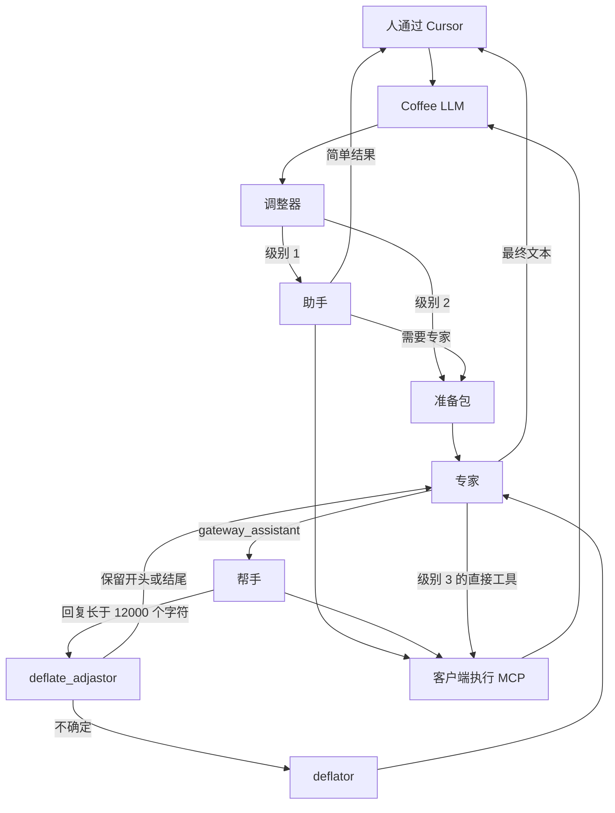

# Coffebreak AI Context Gateway

[English](README.md) · [Русский](README.ru.md) · [简体中文](README.zh-cn.md)

[](pyproject.toml)

[](https://github.com/coffeebreak-ai/coffee-llm/commits/main)
[](https://github.com/coffeebreak-ai/coffee-llm/issues)
[](https://github.com/coffeebreak-ai/coffee-llm/pulls)

这是放在昂贵模型前面的个人网关。在 Cursor 和 Codex 中模型名叫 `Coffee LLM`。代码和命令里不带空格的名字是 `coffee_llm`。人只对着一个地址说话，由网关决定这一步谁来主导：助手收集数据，专家判断并回答。

## 使命

昂贵模型得到的是判断，而不是对话和工具输出的原始档案。收集、搜索和继续阅读由更便宜的助手完成。任务需要时，仍由专家向人给出最终表述。

## 目标

- 减少专家每次调用和每个已完成任务的输入令牌。
- 保住供应商缓存命中：已经发给专家的请求开头只做追加。
- 不丢失规则、人的当前发言、路径、行号，以及取回完整来源的办法。
- 外部工具的请求留给模型。与 MCP 服务器的连接由客户端打开。

完整的步骤契约、边界和任务列表留在本地，不进入这个仓库。

## 「专家 — 助手」模式

专家掌握与人的对话，不会收到每一次中间的 Read 或 Grep。助手处理简单任务，或完成专家交来的一件完整委托，并交回一个结果。

步骤形态的参照是 [DeepSeek Harness](https://github.com/deepseek-ai/deepseek-harness)：一次模型步骤连同它的工具，以及一份不重建的历史。稳定前缀和在昂贵调用前压缩上下文的想法来自那里。插件目录和配置树不搬过来。专家与助手的分工是这个网关自己的路线。

访问只有三级，并且只升不降。没有从 `1` 直接到 `3`，也没有降级。

| 级别 | 谁回答人 | 工具 |
| --- | --- | --- |
| 1 | 助手 | 客户端请求中的完整目录 |
| 2 | 专家 | 只有 `gateway_assistant`；助手获得完整目录 |
| 3 | 专家 | 完整目录和 `gateway_assistant` |

调整器选择 `1 → 2` 时没有数值门槛：如果整个结果不能有把握地留给助手，这一步就交给专家。`2 → 3` 需要 `ADJUSTER_ESCALATION_CONFIDENCE`（默认 `0.80`）。这是对「专家需要直接工具」的把握，不是对数据真伪的评价。助手的各步骤之间不调用调整器。

在级别 2，专家可以在同一条回复里委托几件彼此独立的任务。每一件都是单独一次 `gateway_assistant` 调用。助手按顺序工作；需要的外部调用交回客户端。模型发出调用，客户端打开 MCP，并在下一条消息带回结果。网关自己不连接 MCP 服务器。

## 如何组装



新对话在 `COMPACT_EXPERT_CONTEXT=on` 时，助手在专家第一次调用之前把包准备一次。代码原样放入必要规则和人的当前发言。此后专家的工作历史只追加；旧对话不迁到新格式。

助手子对话结束后，专家收到的是一份结构化结果，而不是每一步。不超过 12 000 个字符的片段原样通过。更长的由 `deflate_adjastor` 处理：保留开头、保留结尾，或者看不清时把文本交给不带工具的 `deflator` 挑选片段。完整结果可按 `source_id` 取得。外部调用不删除，仍然交回客户端。

## 仓库结构

对话编排集中在 `coffee_llm/dialogue/`：`engine.py` 管理对话状态和路由，`expert.py`、`helper.py`、`packet.py` 与 `deflate.py` 实现相关流程。顶层的 `coffee_llm/expert.py`、`helper.py`、`packet.py` 和 `deflate.py` 保留为显式兼容导出。入口 `coffee_llm/__main__.py` 保持原位。

## 指标

测于 2026 年 10 月 29 日。这些运行的角色：专家和「仅专家」是 `gpt-6.1-sol`，力度 `medium`；助手是 `gpt-6-luna`，力度 `medium`；调整器和 `deflate_adjastor` 是 `jev-latest`；`deflator` 是 `gpt-6-luna`。调整器和压缩的令牌不在表中。指标很少，已算出的都在下面：输入和缓存。节省只保留输入的百分比：「仅专家」减去「专家」。

### 阅读与比较

| | 输入 | 缓存 |
| --- | ---: | ---: |
| 专家 | 95 750 | 6 533 |
| 助手 | 375 067 | 138 839 |
| 仅专家 | 759 777 | 748 922 |
| 节省 | 87 % | |

### 修改代码

| | 输入 | 缓存 |
| --- | ---: | ---: |
| 专家 | 353 805 | 200 580 |
| 助手 | 3 978 256 | 2 914 298 |
| 仅专家 | 5 732 661 | 5 314 802 |
| 节省 | 94 % | |

## 快速启动

需要 Python 3.15 或更新版本。`pyproject.toml` 没有第三方依赖，不需要通过 `pip` 安装。即使使用本地模型也必须有 `OPENAI_API_KEY`：默认情况下专家（`gpt-6.1-sol`）和助手（`gpt-6-luna`）使用 OpenAI Responses API。OpenAI 的默认地址是 `https://api.openai.com/v1`。

1. 在仓库根目录把 `.env.example` 复制为 `.env`，并设置 `OPENAI_API_KEY`。
2. 默认情况下调整器通过本地 Ollama 运行。安装并启动 Ollama，然后执行 `ollama pull nimble-v3:latest`。若用 Jev，设置 `ADJUSTER_BACKEND=jev` 和 `JEV_API_KEY`；调整器就不再需要 Ollama，但 `OPENAI_API_KEY` 仍然必须有。
3. 在仓库根目录启动网关：

```bash
python3 -m coffee_llm
```

标准 `PORT=8080` 时，网关监听 `http://127.0.0.1:8080`。如果 Cursor 在另一台机器上，对这个端口启动 ngrok：

```bash
ngrok http 8080
```

在 Cursor 中把 OpenAI 兼容的 Base URL 设为 ngrok 打印出的 https 地址，并在末尾加上 `/v1`。选择模型 `Coffee LLM`。ngrok 只把请求送到本机网关。不要把隧道指向 MCP 或 Graphiti 端口。

同一台机器上的 Codex 读取 `~/.codex/config.toml`，不读取 `config.yaml`。指向网关后，完全退出并重新打开 Codex：

```toml
model = "Coffee LLM"
model_provider = "coffee"

[model_providers.coffee]
name = "Coffee LLM"
base_url = "http://127.0.0.1:8080/v1"
wire_api = "responses"
requires_openai_auth = false
```

如果 Codex 在另一台机器上，把 `base_url` 设为 ngrok 的 https 地址，并在末尾加上 `/v1`。

Graphiti 是可选的：网关有它能工作，没有它也能工作。Open WebUI 的分步说明留在本地，不进入这个仓库。所有密钥只放在本地 `.env`；它和 `data/` 不进入 Git。

许可证 [MIT](LICENSE)。
